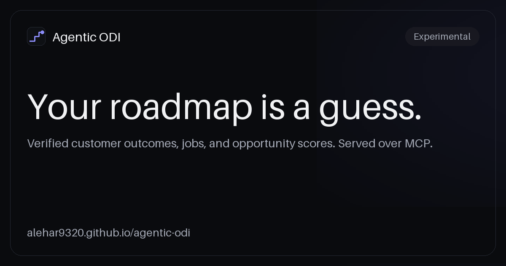

<div align="center">


# Agentic ODI

[](https://github.com/alehar9320/agentic-odi/actions/workflows/ci.yml)
[](https://codecov.io/gh/alehar9320/agentic-odi)
[](https://www.python.org/downloads/)
[](https://docs.astral.sh/uv/)
[](https://github.com/astral-sh/ruff)
[](https://github.com/jlowin/fastmcp)
[](https://pytest.org)
[](https://modelcontextprotocol.io)
[](https://buymeacoffee.com/signup)

### Your roadmap is a guess. This makes it evidence.

An **MCP server** that hands your agents verified customer outcomes — the jobs,
desired outcomes, and opportunity scores that rank them.

**Try it now — nothing to install, nothing to connect.** Open the Studio in any
browser and it works from the first minute: canvas, thread, and assistant all
run on your device, with no account and no server. The local app (any OS) and
the sidecar elevate your capabilities when you're ready — they never block you.

[](https://agentic-odi.alehar.workers.dev/)
[](https://alehar9320.github.io/agentic-odi/sample/)

Want to see what it produces first? [Open the sample
workspace](https://alehar9320.github.io/agentic-odi/sample/) — a read-only job,
its scored outcomes, and the evidence behind them, generated from a committed
fixture and labelled a sample on every row.

> **[](https://github.com/alehar9320/agentic-odi)**



The project card, rendered from the committed source by
`website/tools/make_og.py`.

</div>

---

## Why this exists

- **Roadmaps are set by whoever talks loudest.** Decisions default to seniority,
  not evidence.
- **Teams build features for customers who never asked.** The idea gets
  validated; the outcome never does.
- **Agents are fluent in everything and grounded in nothing.** A model will
  confidently invent your customer.

## What you get

| What you get | Where to look |
|---|---|
| **A brain for customer needs.** Jobs, desired outcomes, evidence, and opportunity scores in one store — queryable by any MCP client. | [The method →](docs/method.md) |
| **The other half of ODI.** Stage 5 clusters the scored outcomes into segments — a group of people plus a functional job, never a demographic — and Stage 6 recommends the one innovation path those segments support, with every path it rejected and why. | [The method →](docs/method.md) |
| **A conversation, not a form.** The Living Studio opens on one question — **What do you want to win?** — with the composer focused. When you ask for context, the agent speaks first, and the answers come back as a brief you can edit line by line. Every claim in a reply names the record behind it, or says it is a hypothesis. | [The Living Studio →](docs/living-studio.md) |
| **A document when the conversation needs one.** `/brief` writes the decision brief from the canvas — the ranked bets, the records behind each, what argues against them, and the next evidence to collect — as Markdown a review can read with or without the Studio. Provenance travels with it: demo rows are excluded from every count and labelled. | [The Living Studio →](docs/living-studio.md) |
| **Evidence becomes outcomes.** An ingested record is mined into a scored, approvable outcome proposal — statement, direction, importance, satisfaction, and a stated confidence, with its rationale and the quote it came from. The mining is deterministic and offline. | [The method →](docs/method.md) |
| **A catch-up that means something.** Writes emit signals — an outcome re-scored, evidence promoted, a job map completed — stored in the same event log and read by the CLI, any MCP client, and the Studio's bell. Nothing is invented, and the feed is deduped and budgeted. | [CLI reference →](docs/cli.md) |
| **Connectors, without storing a credential.** Register MCP or REST connectors (Notion, PostHog, Exa, Linear, GitHub) from a trusted vendor marketplace, conversationally, or from the CLI. A listing that needs a token names the environment variable to set. | [External Connectors →](docs/connectors.md) |
| **Browser-first, local-second.** The Studio opens in any browser and is fully usable with no account, no server, and no sidecar: jobs, outcomes, memory, and the assistant all run locally on your device. The desktop app (any OS) and the sidecar elevate your capabilities — local LLM proxy, connectors, MCP passthrough, updates — when you choose to add them. Start on web or mobile, then graduate to the CLI or local app as you get deeper. | [Local LLM Backend →](docs/local-llm.md) |

**How you start.** Open the Studio on the web (desktop or mobile) or connect any
MCP client to the local server. Everything works right there. When you want more
power — a local model, third-party connectors, a desktop shell — install the local
app. The sidecar elevates; it never blocks. You can stay in the browser forever,
or move to the CLI and then the local app as you become more embedded in the
service.

### Also in the box

- **Typed entity links in the core domain model.** `Link` and `RelationshipType`
  in `packages/core` describe typed, AI-native relationships between ODI
  entities (such as `evidence` serving an `outcome`, `blocked_by`, or
  `external_jira`/`external_github` references) with optional external
  identifiers and cached previews, currently scoped to the core domain model.
- **One artifact you can hand over.** A read-only link opens a single artifact
  and its evidence on its own page — no rail, no composer, no way into the rest
  of the workspace — and states when the link expires. The link is a capability,
  not a copy of the database.
- **A check on whether onboarding works.** Five counters — launch, first message,
  first outcome, first score, return session — appended to the same local event
  log and read back by `agentic-odi stats`. The numbers never leave the machine,
  and a counter that has not happened reads as zero rather than a guess.
- **The agent knows what you are looking at.** Select a job, step, outcome, or
  evidence record and the Studio tells the sidecar only *which* record — kind and
  id — never what it says.
- **A desktop app and an offline shell.** Tauri 2 desktop builds open in a
  focused window that remembers its size and place, update themselves in the
  background, and a service worker precaches the built shell so the Studio opens
  with no network.
- **Odi the Otter.** The mascot appears in the CLI, the Studio, the desktop icon,
  and this page. See [Brand](#brand).

## Supported platforms

Grab a prebuilt archive for your machine — each one clicks straight to
`releases/latest/download/<asset>`:

[](https://github.com/alehar9320/agentic-odi/releases/latest/download/odi_0.14.0_linux_x86_64.tar.gz)
[](https://github.com/alehar9320/agentic-odi/releases/latest/download/odi_0.14.0_macos_arm64.tar.gz)
[](https://github.com/alehar9320/agentic-odi/releases/latest/download/odi_0.14.0_macos_x86_64.tar.gz)
[](https://github.com/alehar9320/agentic-odi/releases/latest/download/odi_0.14.0_windows_x86_64.zip)

## Install

**One line, Linux and macOS.** Both installers verify the download against
`checksums.txt`.

```bash
curl -fsSL https://github.com/alehar9320/agentic-odi/releases/latest/download/install.sh | sh
```

**One line, Windows (PowerShell).**

```powershell
iex (Invoke-WebRequest -Uri https://github.com/alehar9320/agentic-odi/releases/latest/download/install.ps1 -UseBasicParsing)
```

**Direct download buttons.** One-click links to the latest platform assets:

[](https://github.com/alehar9320/agentic-odi/releases/latest/download/odi_latest_linux_x86_64.tar.gz)
[](https://github.com/alehar9320/agentic-odi/releases/latest/download/odi_latest_macos_arm64.tar.gz)
[](https://github.com/alehar9320/agentic-odi/releases/latest/download/odi_latest_macos_x86_64.tar.gz)
[](https://github.com/alehar9320/agentic-odi/releases/latest/download/odi_latest_windows_x86_64.zip)

Every [release](https://github.com/alehar9320/agentic-odi/releases/latest) also
carries a per-platform SHA-256 table. See
[Installation](docs/installation.md) for the archive list, the install layout,
the updater, and how a release is cut.

**Package managers.** The CLI is a `uv`-managed Python workspace, so you can run
it from source with [uv](https://docs.astral.sh/uv/) instead of a binary:

```bash
uv sync --all-packages
uv run odi --version
```

**Run the full stack locally.** Prerequisites: Python 3.10+,
[uv](https://docs.astral.sh/uv/), and Node.js for the Studio build.

```bash
git clone https://github.com/alehar9320/agentic-odi.git
cd agentic-odi
uv sync --all-packages              # install the whole workspace
npm --prefix apps/studio run build  # build the Living Studio once
uv run python scripts/dev.py        # start the MCP server + Studio together
```

| Service | URL |
|---|---|
| MCP Server | http://localhost:8000/mcp |
| The Living Studio | http://127.0.0.1:8100 |

Run the MCP server on another port with `python -m agentic_odi_mcp_server --port 8010`
or `AGENTIC_ODI_MCP_PORT=8010`. The flag wins over the environment variable.

- **Hot reload:** `npm --prefix apps/studio run dev:full` (Vite on
  http://localhost:5173).
- **Desktop app:** `npm --prefix apps/studio run tauri dev`.
- **No model? No problem.** Without an OpenAI-compatible LLM every job, step,
  and outcome stays editable by hand. See [Local LLM Backend](docs/local-llm.md).
- **A real conversation runtime.** The Studio uses assistant-ui over its
  sidecar-owned transcript, with attachments, tool traces under one foldable
  work row per turn, opt-in approvals for
  chat writes and unknown tools, and branch-aware editing and regeneration.
  Every turn says who said it and when: your own turn carries a name, an
  initial, and a time, the agent's carries its sparkle avatar, and a restored
  turn keeps the moment it was written while a turn with no time shows none.
  The thread sits under a title bar that names the inquiry and quietly flags a
  sample or offline canvas. Settings → About says where the app is running —
  desktop app, installed web app, or browser tab — and whether the offline
  shell is on, and offers an opt-in, redacted local diagnostics preview; no
  report is uploaded. See [The Living Studio](docs/living-studio.md).
- **Just the CLI:** it is local-first, so data commands need no server at all.

```bash
odi jobs list
odi desired-outcomes list --job-id <id>
odi studies open --job <id> --name "Invoice sweep" --wave 1   # one pass; re-running is a new wave
odi segments run --job <id>          # Stage 5: who the scored outcomes point at
odi strategy propose                 # Stage 6: the bet, and the paths it beat
odi signals unread                    # what changed while you were away
odi score 8 2                        # → 14.00
odi                                  # interactive chat in a terminal
```

## How it works

Outcome-Driven Innovation asks customers two numbers per outcome — how much it
**matters** and how **satisfied** they are today. The gap is where products win
or die:

```text
Opportunity Score = Importance + max(Importance − Satisfaction, 0)
```

Score **> 10** → underserved, innovate. **= 10** → served, maintain.
**< 10** → overserved, disrupt. ODI reports an **86% innovation success rate**
(as reported in the [Strategyn](https://strategyn.com/outcome-driven-innovation/) literature).

When an outcome comes from a single evidence record, that record's confidence
weights the two inputs **before** the formula runs — `verified` counts in full,
`claimed` counts at half — so a score built on a claimed quote cannot outrank one
built on verified interviews. The formula above is unchanged; the stored inputs
are the weighted ones, so the score always matches them.

A score says *which outcome* to chase; the job map says *who* is underserved.
Stage 5 clusters a job's scored outcomes by the step they attach to, and Stage 6
recommends one of three paths — differentiated for an underserved segment,
disruptive for an overserved one, new-market for outcomes that map to no job in
the store — recording the two it rejected. An outcome that joins no cluster is
reported as unclustered, never inflated into a market.

## Connect your agent

The server speaks the Model Context Protocol. Any MCP client can reach it:

```json
{
  "mcpServers": {
    "agentic-odi": { "url": "http://localhost:8000/mcp" }
  }
}
```

Register MCP or REST connectors (Notion, PostHog, Exa, Linear, GitHub, Composio) on the
Studio's **Customize** page — installed connectors first, then a trusted vendor
marketplace, then conversationally, or via `agentic-odi connectors add <preset>`.
A listing that needs a token names the environment variable to set; no credential
is stored in the app. MCP servers install today; A2A agents are marked "coming
soon". See [External Connectors](docs/connectors.md).

## Documentation

<!-- BEGIN GENERATED: docs -->
| Guide | Contents |
|---|---|
| [Installation](docs/installation.md) | Binaries, the installer, and updates. |
| [The Living Studio](docs/living-studio.md) | The chat-first interface, its first run, and the desktop app. |
| [Local LLM Backend](docs/local-llm.md) | Running a local OpenAI-compatible model with tool calling. |
| [The Method, Stage by Stage](docs/method.md) | The eight job-map stages as a practitioner works them. |
| [CLI Reference](docs/cli.md) | Backends, chat, entities, and scoring. |
| [Connectors](docs/connectors.md) | The registry, the presets, and the protocol. |
| [Architecture](docs/architecture/README.md) | The workspace, the data flow, and the testing strategy. |
| [Test map](docs/reference/test-map.md) | Every test file and the one line it says about itself. |
| [Deployment](docs/deployment.md) | The project site, the hosted server, and the Worker. |
| [Development](docs/development.md) | Lint, types, frontend checks, and the coverage map. |
| [The assistant-ui ledger](docs/assistant-ui-ledger.md) | Every assistant-ui capability, and the one honest state it is in. |
| [Agent Assignment](docs/agents.md) | Which agents take issues, how to claim one, and when a claim expires. |
| [Roadmap](docs/roadmap.md) | What has shipped, and what is queued. |
| [Superpowers](docs/superpowers.md) | Pi, OpenCode, and Freebuff integration. |
<!-- END GENERATED: docs -->

Every guide is also published on the
[project site](https://alehar9320.github.io/agentic-odi/docs/), rendered from
these files. The site adds a quick start, a generated MCP tool reference, the
connector catalog, and client-side search over every page (`Ctrl`/`Cmd`+`K`).

## Community & Support

- **Questions and bugs.** [Open an issue](https://github.com/alehar9320/agentic-odi/issues)
  and say what you expected and what happened.
- **Experimental, and honest about it.** This is a feasibility test for using MCP
  with Outcome-Driven Innovation, and we don't publish dates.
- **Buy me a coffee.** If this saved you a roadmap argument,
  [the maintainer takes coffee](https://buymeacoffee.com/signup).
- **Brand.** Odi the Otter is documented in [brand/README.md](brand/README.md).

## Code Overview

A [uv workspace](https://docs.astral.sh/uv/concepts/projects/workspaces/) with
shared tooling at the root. Packages live in `packages/`, runnable services in
`apps/`, and deployment assets in `infra/`. The
[architecture index](docs/architecture/README.md) explains how the pieces fit
together and where each contract is enforced; its Dependency Direction diagram
is a contract of its own — `tests/test_architecture.py` checks the drawn arrows
against the declared dependencies and the real imports, so the picture cannot
drift from the workspace. The distributions are:

<!-- BEGIN GENERATED: packages -->
| Path | Distribution | Description |
|---|---|---|
| **`packages/connectors/`** | `agentic-odi-connectors` | External system connectors for Agentic ODI, including an MCP client ingest connector and REST item previews. |
| **`packages/core/`** | `agentic-odi-core` | Core domain models, services, and repositories for Agentic ODI. |
| **`apps/cli/`** | `agentic-odi-cli` | Command-line interface for Agentic ODI. |
| **`apps/mcp-server/`** | `agentic-odi-mcp-server` | FastMCP server for Agentic ODI. |
| **`apps/studio-api/`** | `agentic-odi-studio-api` | FastAPI sidecar for the Agentic ODI Living Studio. |
<!-- END GENERATED: packages -->

Inside `packages/core` there are four groups, and the rules between them are
written down rather than implied — with `errors.py`, the exception hierarchy, open
to every group. **Domain** (`models.py`, `evaluation.py`, `mapping.py`,
`corpus.py`) is the vocabulary and imports no other group. **Persistence**
(`repository.py`, `sqlite_repository.py`, `intent_store.py`, `events.py`,
`factory.py`, `integrity.py`, `migrations.py`) stores what the other groups
decide and may not import methodology —
`tests/test_architecture.py` enforces that one rule, and also refuses a new core
module that belongs to no group. **Methodology** (`services.py`, `segmentation.py`,
`strategy.py`, `router.py`, `messages.py`, `steve_jobs.py`) owns the service door,
which is `services.py`. **Contract** (`contract.py`, `errors.py`, `remote.py`,
`schema.py`, `connection.py`, `consent.py`) is the MCP wire protocol; anything may
import it and it imports no persistence or methodology. The full table, and the
reason `contract.py` is not its own package yet, is in
[ADR 0005](docs/architecture/adr/0005-core-layers-and-the-contract-split.md).

## Contributing

Open a pull request against the **default** tier in
[`.agents/workflows/test.md`](.agents/workflows/test.md) — that is the bar.
The fast tier (pytest on the changed packages, `uv run ruff check .`) is a
quick answer on the changed slice; the full tier (the studio build and the
browser e2e suite) is CI's job and is not asked of anyone before they open a
pull request.

```bash
uv run ruff check . && uv run ruff format --check .
uv run python scripts/verify.py --changed  # PR bar; see .agents/workflows/test.md
uv run python scripts/doc_check.py   # documented commands, paths, routes, env vars, and the assistant-ui ledger hold up
uv run python scripts/docs_index.py --write   # regenerate the Code Overview table from the workspace
```

See [Development](docs/development.md) for the frontend checks, the coverage
map, and how every pull request is automatically risk-classified.
The browser-level Studio suite runs in its own non-blocking CI job; set the
repository variable `AGENTIC_ODI_E2E` to `false` to skip it.

A `dependencies` CI job fails a pull request that pins a high-severity advisory
in the Python, npm, or Cargo dependency set. Accepted advisories live in
`security/audit-ignore.toml` with an expiry date; see
[ADR 0008](docs/architecture/adr/0008-dependency-advisories-are-a-gate.md).

## Brand

**Odi the Otter** is the mascot — a golden-ratio-derived pixel otter appearing in
the CLI, the Studio, the desktop icon, and this page. The artwork is original,
generated by a committed script, and documented in
[brand/README.md](brand/README.md).

```bash
uv run python brand/tools/render.py   # regenerate every Odi asset
```

## License

MIT — see [LICENSE](LICENSE).

---

<div align="center">

*Let's build AI that builds what people actually need.*

</div>
