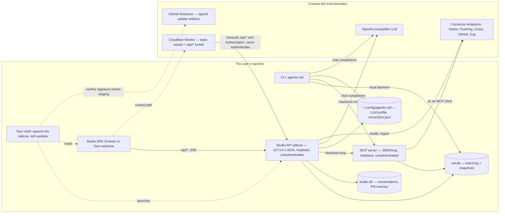
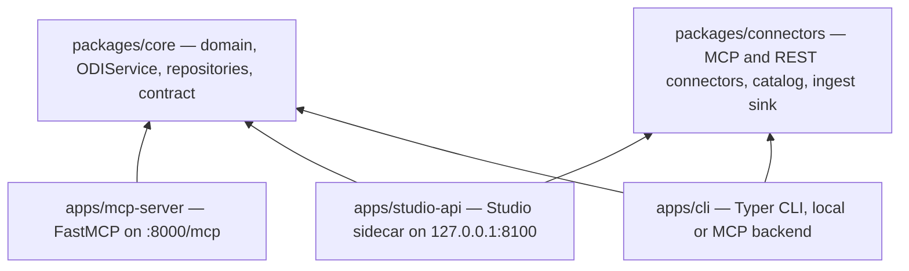

# Repository Architecture

Agentic ODI is a uv workspace with a single root `pyproject.toml` for shared tooling. Python distributions are imported by their stable `agentic_odi_*` package names; directory layout does not leak into imports.

## The system at a glance

Every process, the state it may reach, and the boundary that leaves the machine.
The reach table behind it is [Trust boundaries](trust-boundaries.md); the arrows
between workspace packages are the next section.



## Layout

```text
apps/
  cli/            agentic_odi_cli         Typer CLI: local SQLite or remote MCP
  mcp-server/     agentic_odi_mcp_server  FastMCP server over HTTP
  studio-api/     agentic_odi_studio_api  FastAPI sidecar for the Studio SPA
  studio/         React + TypeScript + Vite SPA and Tauri 2 shell
                   e2e/         Browser-level Playwright suite
packages/
  core/           agentic_odi_core        Domain, services, repositories, contract
  connectors/     agentic_odi_connectors  MCP client connectors and catalog
infra/cloudflare/ Worker script; wrangler.jsonc lives at the repo root
scripts/          Dev launcher, binary build, installer checks
tests/            Cross-package contract and launcher tests only
docs/             Architecture, reference material, Superpowers artifacts
packaging/        PyInstaller spec for the CLI binary
```

## Dependency Direction

An arrow points from the importer to the imported.



This picture is a contract, not an illustration. `tests/test_architecture.py`
reads the arrows above and asserts they equal both the `[project] dependencies`
each member declares and the imports the source actually contains, in both
directions. Add a workspace dependency without drawing it, draw one that nothing
imports, or import a package you never declared, and the suite names the edge and
the file to edit. Node ids are import package names; the distribution name is the
same with underscores replaced by hyphens.

To see the boundary move rather than sit still, read the picture's history:
`git log -p -- docs/architecture/README.md`. Every arrow that moved for a reason
has an [ADR](adr/README.md) saying why, which is why the diagram lives in this
file instead of a generated image — a change to a picture has to be reviewable as
a change.

- `packages/core` depends on no other workspace package.
- `packages/connectors` also depends on no workspace package: it defines its own
  `EvidenceDraft` rather than importing `core`'s `Evidence`. Whether that
  separation is deliberate is an open question, recorded in
  [the architecture critique](../superpowers/specs/2026-10-31-architecture-critique-design.md).
- Every runnable app may depend on `core`; none of them imports another app.
- The React SPA only talks to `apps/studio-api` over `/api`; it never calls MCP or the LLM directly.
- The SPA's conversation runtime is assistant-ui, bound to the Studio's own
  store in `apps/studio/src/assistant/`. That directory
  is the whole bridge: `convert.ts` maps the two message models in both
  directions, `StudioRuntime.tsx` wires the runtime callbacks, and
  `attachments.ts` extracts files in the browser. The library is presentation
  only — it holds no product state and makes no network calls of its own.

## Persistence

- `SQLiteRepository` is the production default for the CLI, MCP server, and Studio API.
- The default database is `~/.agentic-odi/odi.db`, overridable with `AGENTIC_ODI_DB`.
- Studio conversation history and PM memory use a separate SQLite database,
  `~/.agentic-odi/studio.db`, overridable with `AGENTIC_ODI_STUDIO_DB`. They are
  sidecar-local and never enter the ODI repository or the MCP contract.
- `build_repository()` chooses SQLite by default and `InMemoryRepository` when `AGENTIC_ODI_DB=:memory:`, which is what tests use.
- The CLI selects its backend with `--backend local|mcp` or `AGENTIC_ODI_BACKEND`.
- The Studio API selects `local` (direct service calls) or `mcp` (passthrough) with `AGENTIC_ODI_BACKEND` or `create_app(backend=...)`.
- The Studio keeps the last focused subject in `localStorage` under
  `studio.session` (`job_id`, `step_id`, `outcome_id`), so a reload reopens the
  same job, step, or outcome. This is browser state, not sidecar state: there is
  no server session and nothing is shared between browsers. Evidence has no
  session slot, so focusing evidence leaves the stored context untouched.

## MCP Contract

`packages/core/src/agentic_odi_core/contract.py` owns `ToolName`, `ToolSpec`, `TOOL_SPECS`, and `TOOL_NAMES`. The live FastMCP registry is asserted against it by `tests/contract/test_mcp_contract.py`; the CLI's local handlers are checked by `tests/contract/test_cli_contract.py`. The MCP server also validates the contract against its live registry at startup and exits before serving if any tool is missing or misdeclared.

## Entry Points

| Command | Module |
|---|---|
| `agentic-odi` | `agentic_odi_cli.cli:app` |
| `agentic-odi-server` / `agentic-odi-mcp-server` | `agentic_odi_mcp_server.mcp_server:main` |
| `agentic-odi-studio-api` | `agentic_odi_studio_api.main:main` |
| `uv run python scripts/dev.py` | Dev launcher (MCP + Studio API) |

## Pull Request Guardrails

`.github/workflows/pr-guardrails.yml` runs three gates on the cumulative
`base...HEAD` diff, so a tree-replacement commit buried in the middle of a
branch is still visible:

- **diff-shape** (blocking): refuses to delete a file that exists on the base
  branch unless it is listed in `.github/pr-guardrails/deletion-allowlist.yml`;
  refuses a diff that deletes more than `max_deletions` lines or changes more
  than `max_changed_files` files, excluding regenerated files. Thresholds live
  in `.github/pr-guardrails/config.yml`.
- **body-truth** (warns; the fenced JSON diff summary blocks): compares
  natural-language file/test claims and the machine-readable block against the
  real diff.
- **fabrication** (warns): flags new `TODO`/`FIXME`/`NotImplementedError`/stubs,
  unconditional `is_available`, hardcoded measurements, and "mock" returns.

The logic lives in `scripts/pr_guards.py`; the YAML only gathers the diff.
Unit tests are in `tests/scripts/test_pr_guards.py`.

Repository ruleset `main-requires-ci-green` (id `25356329`) requires both
`CI green` and `PR guardrails`, sets
`strict_required_status_checks_policy: true`, and keeps the admin bypass only
for pull requests (`bypass_mode: pull_request`). Rulesets are repository
settings, not files; change them with `gh api` and record it here.

## Documents

Start here, then take the one that answers your question.

| Document | One line |
|---|---|
| [ODI contract](odi-contract.md) | The methodology rules — format, score, stages — and where each is enforced. |
| [Data flow](data-flow.md) | How a write and a read travel from the CLI, MCP, and Studio to storage and back. |
| [The signal inbox](notifications.md) | The operational surface of signals: kinds, dedupe, budget, and how each client reads them. |
| [Signals](signals.md) | The design behind signals: why they are events, what they must describe, and what they do not do. |
| [Evidence mapping](evidence-mapping.md) | How a connector record becomes an evidence draft, and how evidence is promoted. |
| [Consent and approvals](consent.md) | What the conversational agent must ask before it writes, and what is not covered. |
| [Trust boundaries](trust-boundaries.md) | What each process may reach, where credentials live, and what crosses the wire. |
| [The generative UI protocol](ui-protocol.md) | The closed catalog, validation on both ends, limits, and the action model. |
| [Studio banners](banners.md) | The Studio's unified notice system. |
| [Reuse first](reuse.md) | The ladder an agent walks before writing new code, its bounds, and the ledger a copy-in must appear in. |
| [Vendor alley](vendor.md) | What may be copied into `src/vendor`, and how the boundary is enforced. |
| [Testing](testing.md) | Test layout, commands, and what each suite is responsible for. |
| [Agent assignment](../agents.md) | Which agents can take an issue, how a claim is recorded, and what expires. |
| [Decisions (ADRs)](adr/README.md) | Why the architecture looks the way it does. |

## Related

- [Data flow](data-flow.md)
- [Studio banners](banners.md)
- [Testing](testing.md)
- [Decisions (ADRs)](adr/README.md) — why the architecture looks the way it does
- [Architecture critique, 2026-10-31](../superpowers/specs/2026-10-31-architecture-critique-design.md)
  — an outside read of the whole system: what is sound, what is at risk, and what
  each finding costs to fix

## What this does not do

This index describes the repository's architecture, not a deployment guide, an
API reference, or a tutorial. It does not cover historical designs — those live
under `docs/superpowers/` as a frozen record — and it does not promise
capabilities that are still open issues; each document links its own gaps.
