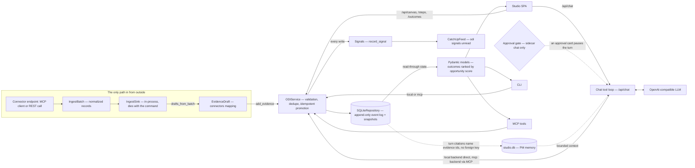

# Data Flow

## The Shape

Connectors are the only way data enters from outside the local store. Reads
project the same repository three ways, and every write emits signals.



The detail is below; this is the shape the rest of the document explains.

## Sources of Truth

| Layer | Owns | Persists |
|---|---|---|
| `packages/core` | `Job`, `Step`, `Outcome`, `CustomerOutcome`, `Signal`, `ODIService`, repository protocol | SQLite event log + snapshots |
| `apps/mcp-server` | MCP tool adapters over `ODIService` | `build_repository()` selects SQLite in production and in-memory for `AGENTIC_ODI_DB=:memory:` |
| `apps/studio-api` | Studio API, canvas projection, chat tool loop, conversation history, PM memory | Via the same repository when the local backend is active; conversations and memory in `~/.agentic-odi/studio.db` |
| `packages/connectors` | Connector protocol, presets, record mapping | Shared `connectors.json` registry; ingested batches land in an in-process sink |
| `apps/studio` | Presentation state, the visible conversation path, optimistic canvas updates; the conversation runtime is assistant-ui | Browser cache only |
| `apps/cli` | Terminal rendering, local/remote backend selection | SQLite directly for `local`, no local writes for `mcp` |

## Write Paths

### Local CLI

```text
agentic-odi customer-outcomes add
  -> LocalBackend
  -> ODIService
  -> SQLiteRepository
  -> IntentStore (append) + snapshot refresh
```

### MCP

```text
MCP client / Studio MCP mode / CLI --backend mcp
  -> FastMCP tool
  -> ODIService
  -> configured Repository
```

`apps/mcp-server` builds its repository once at import time with `build_repository()`. Production uses SQLite; tests set `AGENTIC_ODI_DB=:memory:` (the root test suite does this in `tests/conftest.py`).

### Studio API

```text
apps/studio SPA
  -> /api/canvas, /api/steps, /api/outcomes
  -> backend=local: ODIService -> Repository
  -> backend=mcp:   call_mcp_tool -> MCP server -> ODIService -> Repository

apps/studio SPA
  -> /api/chat
  -> stream_chat -> OpenAI-compatible LLM -> MCP tool calls
  -> StudioMemory (conversation turns + remembered observations)

apps/studio SPA
  -> POST /api/approvals/{id}
  -> ApprovalRegistry -> resolves the paused turn's pending gate

apps/studio SPA
  -> POST /api/models
  -> probes.list_models -> OpenAI-compatible LLM (model ids)
```

`/api/models` is read-only discovery for the composer's picker. It answers the
SPA rather than the browser because the model server may only be reachable from
the sidecar's host and is not necessarily CORS-open. A refused connection is
returned as `error` beside an empty list, not as a 5xx: an unreachable model
server is a normal state the picker explains.

The studio memory is a separate SQLite file, not an ODI repository. It never
feeds the canvas; it only supplies bounded context to the next chat turn.

The SPA sends `mcp_url` with every data request for compatibility. In `local` mode the sidecar ignores it; in `mcp` mode it is required for canvas and mutations.

### Connectors

Connectors are the one path where data enters from outside the local store, and
it has two halves: a durable registry and a volatile ingest buffer.

```text
connectors add [--preset] / connectors catalog
  -> ConnectorRegistry
  -> connectors.json            (shared registry; `${VAR}` placeholders, no secrets)

connectors ingest [--dry-run]
  -> Connector.ingest()         (MCP client or REST call, bounded by a timeout)
  -> IngestBatch                (normalized catalog/resource/tool_result records)
  -> IngestSink                 (in-process, gone when the command exits)
  -> drafts_from_batch -> add_evidence -> Repository   (only when a link id is given)
```

The sink is a hand-off buffer, not storage: nothing survives the process, and
`--dry-run` stops before both the sink append and the evidence writes. Evidence
mapping is the only way connector data reaches the ODI repository, and it goes
through the same `ODIService.add_evidence` path as a hand-entered record.

## The Conversation

One turn is one SSE stream, and the SPA renders it as typed parts rather than a
string. Events, in the order they can appear:

| Event | Payload | Meaning |
|---|---|---|
| `status` | `phase` | `health_check`, `mcp_tools`, `model`, or `offline` |
| `conversation` | `id`, `title` | The thread this turn belongs to |
| `reasoning` | `text` | Model thinking, rendered in a disclosure, never persisted as prose |
| `delta` | `text` | Prose appended to the open text part |
| `tool` | `name`, `status`, `preview` | `start`, `ok`, `error`, or `declined` |
| `approval` | `id`, `tool_call_id`, `name`, `arguments`, `prompt` | A write is waiting for the person |
| `source` | `id`, `title`, `filename`, `mediaType`, `preview` | What the turn actually read |
| `ui` | `id`, `spec` | A validated generated surface |
| `memory`, `connector`, `canvas_dirty` | — | Side effects the SPA applies without a refresh |
| `message` / `error` | `content` / `StudioError` | Exactly one terminal event |

Approval gates are process-local and single-user. `ApprovalRegistry` holds one
`asyncio` future per pending write; `POST /api/approvals/{id}` resolves it and
the same stream continues with the call or with a declined tool result. A
timeout (300 s), a cancelled turn, or sidecar shutdown closes the gate, so a
turn always terminates.

The SPA owns the visible path; the sidecar owns the record. Turns persist with
`message_id` and `parent_id`, and the conversation stores `head_id`:

```text
GET   /api/conversations                       -> every thread, last touch first
GET   /api/conversations/latest                -> thread + turns (resume)
GET   /api/conversations/{id}/tree             -> branch tree + head
PATCH /api/conversations/{id} {"head_id"}      -> record the visible branch
```

A conversation written before ids existed has none, so the tree endpoint
synthesises a linear chain and old threads still open. `apps/studio` never
invents a branch the sidecar cannot reproduce.

The browser also remembers which thread it was sitting on, so a reload reopens
that conversation instead of the newest one. The stored id is a hint, not an
authority: when the sidecar no longer has the thread, the studio drops the key
and resumes `/api/conversations/latest` quietly rather than reporting it.

## Read Paths

```text
ODIService.get_jobs / get_job_map / get_outcomes
  -> Repository read-through state
  -> Pydantic models
  -> JSON (CLI --json, MCP text payload, Studio canvas)
```

Desired outcomes come back ranked by opportunity score (highest first, unscored
last) unless a caller asks for insertion order. The Studio canvas falls back to
the demo seed only in `mcp` mode when MCP is unreachable or returns no jobs. `local` mode returns exactly what is in the local database, including an empty canvas.

## Configuration

| Variable | Used by | Default |
|---|---|---|
| `AGENTIC_ODI_DB` | core SQLite repository | `~/.agentic-odi/odi.db` |
| `AGENTIC_ODI_BACKEND` | CLI, Studio API | `local` |
| `AGENTIC_ODI_MCP_URL` | CLI, Studio defaults | `http://localhost:8000/mcp` |
| `AGENTIC_ODI_MCP_TIMEOUT` | CLI MCP client calls | `30` seconds |
| `AGENTIC_ODI_MCP_KEEPALIVE` | MCP session keepalive interval | `15` seconds (`0` disables) |
| `AGENTIC_ODI_STUDIO_DB` | Studio API memory | `~/.agentic-odi/studio.db` |
| `AGENTIC_ODI_CONNECTORS_CONFIG` | connectors registry (CLI, Studio, MCP) | `~/.config/agentic-odi/connectors.json` |
| `AGENTIC_ODI_CONNECTOR_TIMEOUT` | connector health/ingest calls | `30` seconds |
| `AGENTIC_ODI_STUDIO_DIST` | Studio API, dev launcher | `apps/studio/dist` |
| `AGENTIC_ODI_REPO_ROOT` | Tauri shell | auto-detected |
| `AGENTIC_ODI_BASE_URL` | CLI chat, Studio chat | `http://localhost:8001/v1` |
| `AGENTIC_ODI_MODEL` | CLI chat, Studio chat | `local-tools-model` |
| `AGENTIC_ODI_API_KEY` | CLI chat, Studio chat | `local` |

## Trust Boundaries

Each process, the credentials it holds, and what crosses every wire are
documented in [Trust boundaries](trust-boundaries.md). The short version: the
SPA trusts only the sidecar; the sidecar reaches MCP and the LLM; MCP is an
unauthenticated local HTTP service and must not be exposed; the hosted Worker
tunnels the sidecar, not MCP; and the Tauri updater verifies signatures before
staging an update.

## The Failure Path

A failure is a first-class result, not an empty success. The path is the same
for the CLI, the sidecar, and the SPA.

```text
MCP tool result (text)
  -> agentic_odi_core.remote.parse_tool_result
  -> StudioError { code, message, detail, suggestion, retryable, request_id }
  -> sidecar: StudioHTTPError -> HTTP status + {"error": StudioError}
  -> SPA: StudioApiError -> FailurePanel (message, detail, suggestion, Retry)
```

- **One error body.** Every HTTP failure is `{"error": StudioError}`. The SPA
  also reads a legacy `{"detail": "..."}` body, so an older sidecar still
  produces a readable message. Write routes no longer wrap their result in
  `{"ok": true, "result": ...}`: a success is the object, a delete is
  `{"deleted": id}`.
- **One terminal chat event.** Every `/api/chat` stream ends with exactly one
  `message` or one `error`. A recoverable tool error stays a tool result the
  model can read, but it is reported as `status: "error"` and counted. A fatal
  failure ends the stream with `event: error` carrying the `StudioError`.
- **Request ids.** The sidecar accepts or mints `X-Request-ID`, echoes it on
  the response, and puts it on every SSE frame. The MCP server's own log line
  and the `Execution` record (#82) do not carry it yet, and authentication
  (#90) is out of scope.
- **The canvas is a union.** `CanvasState` is `loading | ready | empty |
  error`. An empty canvas is an invitation; a failed canvas is a failure panel
  with Retry. The two never look the same.
- **The saved copy is drawn, not hidden.** A canvas read from the browser cache
  is initial state with `kind: "loading"`, so the boards draw it and caption it
  "Saved …" from the cache's `generated_at` instead of covering it with a
  skeleton. The skeleton is kept only for a genuinely empty store, and the
  caption claims no freshness the timestamp does not support. `canvasCached`
  tells a board whether the data on screen came from the cache.
- **The turn log is safe.** One JSON line per turn carries the request id, the
  model, the round and tool counts, the error count, the duration, and the
  outcome. Sensitive keys are dropped rather than redacted, so no token, key,
  or customer quote can reach the log.
- **Two layers of error shaping.** The sidecar (and the Worker that proxies it)
  return the server-shaped `StudioError` over HTTP, so the SPA reads it whole.
  When the sidecar never answers at all — a network failure in the browser — the
  SPA classifies the failure client-side (`TypeError` → `mcp_unreachable`) and
  surfaces the same `sidecar-down` banner strip plus a non-retryable in-thread
  notice, instead of a generic "something went wrong".
- **CLI hints.** `BackendError(message, suggestion)` is rendered as `Error: …` on
  stderr with a trailing `Hint: …` line, so a `BackendError("could not reach MCP
  server …")` tells the user exactly what to start.
- **Hosted proxied path.** The free Cloudflare Worker forwards `/api/*` to
  `SIDECAR_URL`; a missing/unreachable sidecar is reported to the browser as
  `{"error": mcp_unreachable}` with a suggestion to start the sidecar and with
  `X-Request-ID` echoed for support. It is logged on the Worker but never leaks
  internals.

