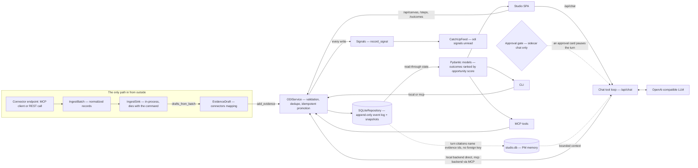

# Data Flow

## The Shape

Connectors are the only way data enters from outside the local store. Reads
project the same repository three ways, and every write emits signals.



The detail is below; this is the shape the rest of the document explains.

## Sources of Truth

| Layer | Owns | Persists |
|---|---|---|
| `packages/core` | `Job`, `Step`, `Outcome`, `CustomerOutcome`, `Signal`, `Conversation`, `Message`, `Observation`, `Brief`, `ODIService`, repository protocol | SQLite event log + snapshots |
| `apps/mcp-server` | MCP tool adapters over `ODIService` | `build_repository()` selects SQLite in production and in-memory for `AGENTIC_ODI_DB=:memory:` |
| `apps/studio-api` | Studio API, canvas projection, chat tool loop, conversation history, PM memory | The same repository: jobs, the thread, and what the agent learned are appended to one event log; the provider key lives in `~/.agentic-odi/studio.json` (`0600`) |
| `packages/connectors` | Connector protocol, presets, record mapping | Shared `connectors.json` registry; ingested batches land in an in-process sink |
| `apps/studio` | Presentation state, the visible conversation path, optimistic canvas updates; the conversation runtime is assistant-ui | IndexedDB (`agentic-odi-studio`) plus named `localStorage` keys — see Storage facts below |
| `apps/cli` | Terminal rendering, local/remote backend selection | SQLite directly for `local`, no local writes for `mcp` |

## Storage facts

`apps/studio/src/bff/storageFacts.ts` answers "where does my data live and how
big is it" from one selector, so whatever renders the answer does not re-derive
it. `storageFacts(store)` reads the store's own snapshot and reports
`{engine, database, bytes, records, lastWrite, persistent}`; `localStorageFacts()`
reports the app's `localStorage` keys with their byte sizes.

Three constraints shape what it is allowed to say:

- `database` is imported from `apps/studio/src/bff/store/indexedDbStore.ts`, not
  restated there — the name is defined once in
  `apps/studio/src/bff/store/migrations.ts` and re-exported. A memory store
  reports `null` and `persistent: false`, because nothing in it survives the tab.
- `lastWrite` is derived. The `meta` store holds only a sequence counter, so no
  write time is recorded anywhere to read; the selector takes the newest
  `updated_at` across jobs, steps, outcomes, observations, and conversations,
  with turn `created_at` as the remaining source.
- `bytes` is the origin's usage from `navigator.storage.estimate()` where the
  browser offers one, and the string `"unknown"` where it does not — never a
  zero that reads like an empty database.

No stored value is ever read. `studio.settings` holds the LLM key (see
[Trust boundaries](trust-boundaries.md)), so the inventory names keys and sizes
and stops there. `APP_STORAGE_KEYS` and `APP_STORAGE_PREFIXES` are that
inventory, and a test fails when a writer uses a `studio.*` or `agentic-odi.*`
key that the inventory does not cover.

## Write Paths

### Local CLI

```text
agentic-odi customer-outcomes add
  -> LocalBackend
  -> ODIService
  -> SQLiteRepository
  -> IntentStore (append) + snapshot refresh
```

### MCP

```text
MCP client / Studio MCP mode / CLI --backend mcp
  -> FastMCP tool
  -> ODIService
  -> configured Repository
```

`apps/mcp-server` builds its repository once at import time with `build_repository()`. Production uses SQLite; tests set `AGENTIC_ODI_DB=:memory:` (the root test suite does this in `tests/conftest.py`).

The thread and the memory are on that contract too — `list_conversations`,
`get_conversation`, `list_observations`, `confirm_observation`,
`dismiss_observation` — so any agent speaking MCP reads the same conversation
and the same confirmed facts as the Studio, rather than the Studio holding a
private version of the person.

### Studio API

```text
apps/studio SPA
  -> /api/canvas, /api/steps, /api/outcomes
  -> backend=local: ODIService -> Repository
  -> backend=mcp:   call_mcp_tool -> MCP server -> ODIService -> Repository

apps/studio SPA
  -> /api/chat
  -> stream_chat -> OpenAI-compatible LLM -> MCP tool calls
  -> StudioMemory (conversation turns + remembered observations)

apps/studio SPA
  -> POST /api/approvals/{id}
  -> ApprovalRegistry -> resolves the paused turn's pending gate

apps/studio SPA
  -> POST /api/models
  -> probes.list_models -> OpenAI-compatible LLM (model ids)

apps/studio SPA
  -> /api/conversations*, /api/observations*, /api/brief
  -> StudioMemory -> ODIService -> Repository (append-only event log)
     (the thread is always the sidecar's own store, in `local` and `mcp` alike)

apps/studio SPA
  -> POST /api/settings {api_key}
  -> StudioSettings -> ~/.agentic-odi/studio.json (0600)   (no LLM, no repository)
```

`/api/models` is read-only discovery for the composer's picker. It answers the
SPA rather than the browser because the model server may only be reachable from
the sidecar's host and is not necessarily CORS-open. A refused connection is
returned as `error` beside an empty list, not as a 5xx: an unreachable model
server is a normal state the picker explains.

The thread and the memory are no longer a private studio database: they are
appended to the same event log as the canvas, so the CLI and the MCP server read
the conversation the Studio had and the observations the agent wrote. The first
time the sidecar opens a file-backed store it imports any pre-core
`studio.db` into that log, once, and renames the file to `studio.db.imported`
rather than deleting it. Storing or restoring a turn never touches the LLM.

Settings are the exception: the provider key is written to `~/.agentic-odi/studio.json`
instead of the event log, because a secret has no place in an append-only stream
that other readers can open. `GET /api/settings` answers with `has_api_key` and a
mask (`sk-…4f2a`), never the value, and a chat turn left without a key gets the
stored one substituted server-side.

### Store open and close

Both SQLite files are gated the same way at open. `IntentStore` and
`StudioMemory` run a bounded `PRAGMA quick_check` (a budget of SQLite VM opcodes
spent through a progress handler) before anything else touches the file; a
damaged file raises `StoreCorrupt` instead of letting a bare
`sqlite3.DatabaseError` escape. The `Repository` protocol carries the result as
`integrity` and exposes `checkpoint(mode)`; `InMemoryRepository` answers `ok` and
no-ops.

The sidecar turns that failure into one structured `store_corrupt` body and
serves a boot failure page; `/health` reports `degraded` while `/health` and
`/api/diagnostics` stay reachable. A damaged file is never deleted or
overwritten.

On a clean stop, the app's lifespan shutdown checkpoints each store
(`wal_checkpoint(TRUNCATE)`) and closes it, so no `-wal` is left for the next
process to recover. Between stops, `AGENTIC_ODI_CHECKPOINT_SECONDS` (default
60, `0` disables) runs a passive checkpoint on a timer.

The SPA sends `mcp_url` with every data request for compatibility. In `local` mode the sidecar ignores it; in `mcp` mode it is required for canvas and mutations.

### Connectors

Connectors are the one path where data enters from outside the local store, and
it has two halves: a durable registry and a volatile ingest buffer.

```text
connectors add [--preset] / connectors catalog
  -> ConnectorRegistry
  -> connectors.json            (shared registry; `${VAR}` placeholders, no secrets)

connectors ingest [--dry-run]
  -> Connector.ingest()         (MCP client or REST call, bounded by a timeout)
  -> IngestBatch                (normalized catalog/resource/tool_result records)
  -> IngestSink                 (in-process, gone when the command exits)
  -> drafts_from_batch -> add_evidence -> Repository   (only when a link id is given)
```

The sink is a hand-off buffer, not storage: nothing survives the process, and
`--dry-run` stops before both the sink append and the evidence writes. Evidence
mapping is the only way connector data reaches the ODI repository, and it goes
through the same `ODIService.add_evidence` path as a hand-entered record.
`EvidenceDraft` is that path's transport shape, not a second domain model: it is
held equal to `Evidence` by `packages/connectors/tests/test_evidence_equivalence.py`,
which fails and names both files when either the fields or the `EvidenceItemType`
vocabulary moves on one side only.

## The Conversation

One turn is one SSE stream, and the SPA renders it as typed parts rather than a
string. Events, in the order they can appear:

| Event | Payload | Meaning |
|---|---|---|
| `status` | `phase` | `health_check`, `mcp_tools`, `model`, or `offline` |
| `conversation` | `id`, `title` | The thread this turn belongs to |
| `reasoning` | `text` | Model thinking, rendered in a disclosure, never persisted as prose |
| `delta` | `text` | Prose appended to the open text part |
| `tool` | `name`, `status`, `preview` | `start`, `ok`, `error`, or `declined` |
| `approval` | `id`, `tool_call_id`, `name`, `arguments`, `prompt` | A write is waiting for the person |
| `source` | `id`, `title`, `filename`, `mediaType`, `preview` | What the turn actually read |
| `ui` | `id`, `spec` | A validated generated surface |
| `memory`, `connector`, `canvas_dirty` | — | Side effects the SPA applies without a refresh |
| `message` / `error` | `content` / `StudioError` | Exactly one terminal event |

Approval gates are process-local and single-user. `ApprovalRegistry` holds one
`asyncio` future per pending write; `POST /api/approvals/{id}` resolves it and
the same stream continues with the call or with a declined tool result. A
timeout (300 s), a cancelled turn, or sidecar shutdown closes the gate, so a
turn always terminates.

The SPA owns the visible path; the sidecar owns the record. Turns persist with
`message_id` and `parent_id`, and the conversation stores `head_id`:

```text
GET   /api/conversations                       -> every thread, last touch first
GET   /api/conversations/latest                -> thread + turns (resume)
GET   /api/conversations?limit=20              -> newest first, archived included
POST  /api/conversations                       -> start a thread
GET   /api/conversations/{id}/messages         -> ordered turns
GET   /api/conversations/{id}/tree             -> branch tree + head
POST  /api/conversations/{id}/messages         -> append one turn
PATCH /api/conversations/{id}                  -> title, archived, or head_id
DELETE /api/conversations/{id}                 -> explicit, confirmed forget
```

`CONVERSATION_CREATED`, `CONVERSATION_UPDATED`, `MESSAGE_APPENDED`,
`OBSERVATION_CREATED` and `OBSERVATION_UPDATED` are appended beside the ODI
events, so a reload restores the exact thread: the same ids, the same parents,
and the same ordered `parts`, including every `ui` spec that was rendered. The
SPA re-validates a stored spec on read and degrades an unknown one to the
`unsupported` card instead of crashing. **New conversation** archives the thread
it was left on rather than erasing it, and a branch that was still running when
the tab died is restored as declined, not pending.

A conversation written before ids existed has none, so the tree endpoint
synthesises a linear chain and old threads still open. `apps/studio` never
invents a branch the sidecar cannot reproduce.

### What the agent learned

`Observation` is the memory primitive: `text` (≤ 300 chars), a `category`, and a
`status` of `proposed`, `confirmed`, or `dismissed`, with provenance back to the
conversation and the message it came from. The `remember` tool can only write a
proposal — the agent never confirms its own memory — and a `memory` SSE frame
carries the whole observation so the panel updates without a refresh.

Only `confirmed_observations()` feeds the system prompt, so a dismissed fact is
gone from context in this session and the next, while still being readable in
the log for the person who wants to see what was thrown away.

## Read Paths

```text
ODIService.get_jobs / get_job_map / get_outcomes
  -> Repository read-through state
  -> Pydantic models
  -> JSON (CLI --json, MCP text payload, Studio canvas)
```

Desired outcomes come back ranked by opportunity score (highest first, unscored
last) unless a caller asks for insertion order. The Studio canvas falls back to
the demo seed only in `mcp` mode when MCP is unreachable or returns no jobs. `local` mode returns exactly what is in the local database, including an empty canvas.

## Configuration

| Variable | Used by | Default |
|---|---|---|
| `AGENTIC_ODI_DB` | core SQLite repository | `~/.agentic-odi/odi.db` |
| `AGENTIC_ODI_WORKSPACE` | core SQLite repository — stamps every conversation, turn, observation, and brief | `local` |
| `AGENTIC_ODI_DEVICE_ID` | core SQLite repository — otherwise the id created once at `~/.agentic-odi/device_id` (`0600`) | that generated id |
| `AGENTIC_ODI_BACKEND` | CLI, Studio API | `local` |
| `AGENTIC_ODI_MCP_URL` | CLI, Studio defaults | `http://localhost:8000/mcp` |
| `AGENTIC_ODI_MCP_TIMEOUT` | CLI MCP client calls | `30` seconds |
| `AGENTIC_ODI_MCP_KEEPALIVE` | MCP session keepalive interval | `15` seconds (`0` disables) |
| `AGENTIC_ODI_STUDIO_DB` | Studio API memory | `~/.agentic-odi/studio.db` |
| `AGENTIC_ODI_BACKUP_DIR` | core recovery, boot failure message | `~/.agentic-odi/backups` |
| `AGENTIC_ODI_CHECKPOINT_SECONDS` | Studio API idle checkpoint interval | `60` seconds (`0` disables) |
| `AGENTIC_ODI_CONNECTORS_CONFIG` | connectors registry (CLI, Studio, MCP) | `~/.config/agentic-odi/connectors.json` |
| `AGENTIC_ODI_CONNECTOR_TIMEOUT` | connector health/ingest calls | `30` seconds |
| `AGENTIC_ODI_STUDIO_DIST` | Studio API, dev launcher | `apps/studio/dist` |
| `AGENTIC_ODI_REPO_ROOT` | Tauri shell | auto-detected |
| `AGENTIC_ODI_BASE_URL` | CLI chat, Studio chat | `http://localhost:8001/v1` |
| `AGENTIC_ODI_MODEL` | CLI chat, Studio chat | `local-tools-model` |
| `AGENTIC_ODI_API_KEY` | CLI chat, Studio chat | `local` |

## Trust Boundaries

Each process, the credentials it holds, and what crosses every wire are
documented in [Trust boundaries](trust-boundaries.md). The short version: the
SPA trusts only the sidecar; the sidecar reaches MCP and the LLM; MCP is an
unauthenticated local HTTP service and must not be exposed; the hosted Worker
tunnels the sidecar, not MCP; and the Tauri updater verifies signatures before
staging an update.

## The Failure Path

A failure is a first-class result, not an empty success. The path is the same
for the CLI, the sidecar, and the SPA.

```text
MCP tool result (text)
  -> agentic_odi_core.remote.parse_tool_result
  -> StudioError { code, message, detail, suggestion, retryable, request_id }
  -> sidecar: StudioHTTPError -> HTTP status + {"error": StudioError}
  -> SPA: StudioApiError -> FailurePanel (message, detail, suggestion, Retry)
```

- **One error body.** Every HTTP failure is `{"error": StudioError}`. The SPA
  also reads a legacy `{"detail": "..."}` body, so an older sidecar still
  produces a readable message. Write routes no longer wrap their result in
  `{"ok": true, "result": ...}`: a success is the object, a delete is
  `{"deleted": id}`.
- **The same envelope over MCP.** A failing tool returns
  `{"error": StudioError, "message": "Error: …"}` as its text: the code,
  retryability, detail, suggestion, and request id travel as data, and the
  sentence stays for a client that only reads prose. `parse_tool_result` tries
  that JSON first and falls back to the prose forms, so a server predating the
  envelope is still understood.
- **One terminal chat event.** Every `/api/chat` stream ends with exactly one
  `message` or one `error`. A recoverable tool error stays a tool result the
  model can read, but it is reported as `status: "error"` and counted. A fatal
  failure ends the stream with `event: error` carrying the `StudioError`.
- **Request ids.** The sidecar accepts or mints `X-Request-ID`, echoes it on
  the response, and puts it on every SSE frame. The MCP server's own log line
  and the `Execution` record (#82) do not carry it yet, and authentication
  (#90) is out of scope.
- **The canvas is a union.** `CanvasState` is `loading | ready | empty |
  error`. An empty canvas is an invitation; a failed canvas is a failure panel
  with Retry. The two never look the same.
- **The saved copy is drawn, not hidden.** A canvas read from the browser cache
  is initial state with `kind: "loading"`, so the boards draw it and caption it
  "Saved …" from the cache's `generated_at` instead of covering it with a
  skeleton. The skeleton is kept only for a genuinely empty store, and the
  caption claims no freshness the timestamp does not support. `canvasCached`
  tells a board whether the data on screen came from the cache. `EvidenceStream`
  follows both halves of that rule: it puts the same caption over rows that
  survived a reload, and it reserves "No evidence captured yet" for a canvas
  that really answered with nothing — while loading it shows a status line and a
  card ghost, and on failure the `FailurePanel` with Retry wired to
  `refreshCanvas`, over the retained rows when there are some and in their place
  when there are none. Evidence empties independently of the workspace, so the
  lens reads `canvasState.kind` itself rather than trusting the canvas-wide
  `empty`, which can announce "nothing here" about a canvas full of jobs.
- **The turn log is safe.** One JSON line per turn carries the request id, the
  model, the round and tool counts, the error count, the duration, and the
  outcome. Sensitive keys are dropped rather than redacted, so no token, key,
  or customer quote can reach the log.
- **Two layers of error shaping.** The sidecar (and the Worker that proxies it)
  return the server-shaped `StudioError` over HTTP, so the SPA reads it whole.
  When the sidecar never answers at all — a network failure in the browser — the
  SPA classifies the failure client-side (`TypeError` → `mcp_unreachable`) and
  surfaces the same `sidecar-down` banner strip plus a non-retryable in-thread
  notice, instead of a generic "something went wrong".
- **CLI hints.** `BackendError(message, suggestion)` is rendered as `Error: …` on
  stderr with a trailing `Hint: …` line, so a `BackendError("could not reach MCP
  server …")` tells the user exactly what to start.
- **Hosted proxied path.** The free Cloudflare Worker forwards `/api/*` to
  `SIDECAR_URL`; a missing/unreachable sidecar is reported to the browser as
  `{"error": mcp_unreachable}` with a suggestion to start the sidecar and with
  `X-Request-ID` echoed for support. It is logged on the Worker but never leaks
  internals.

